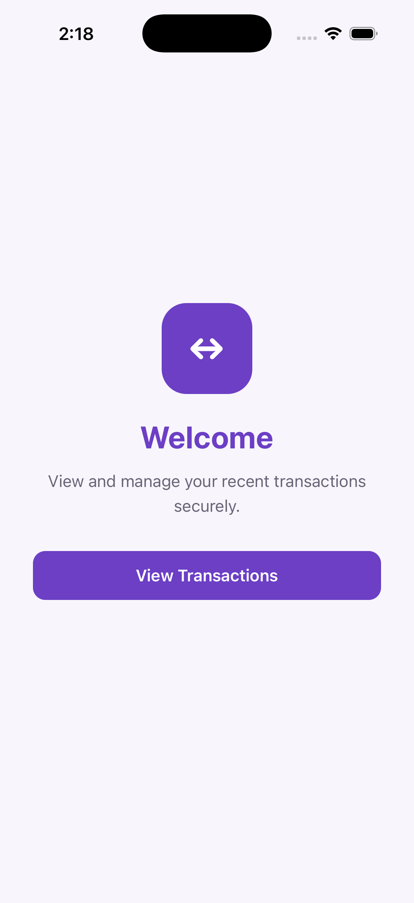
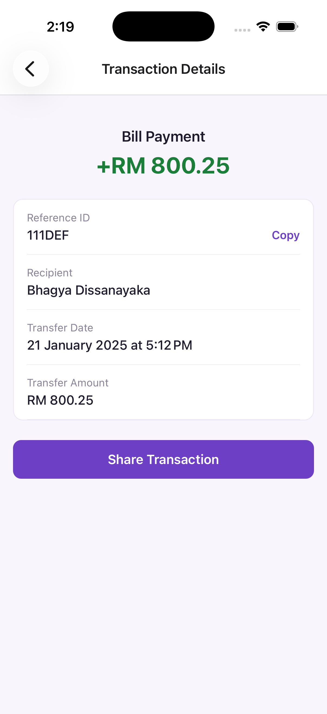
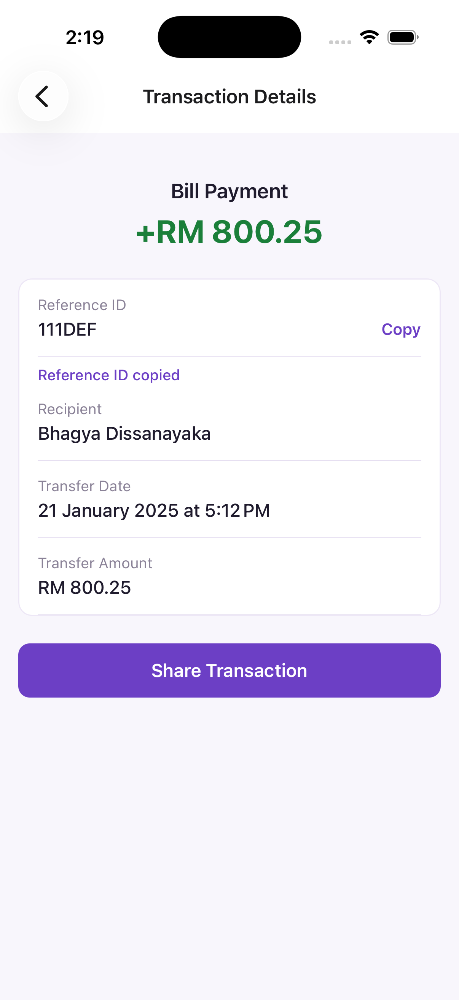
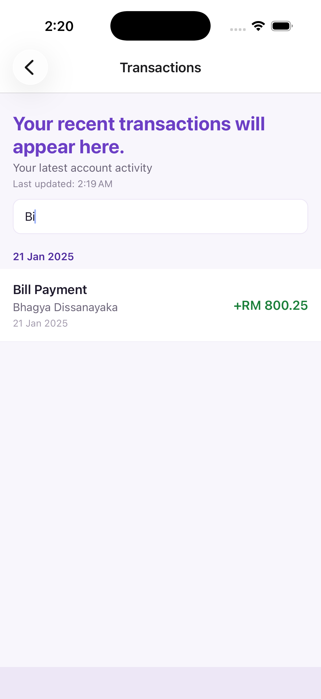
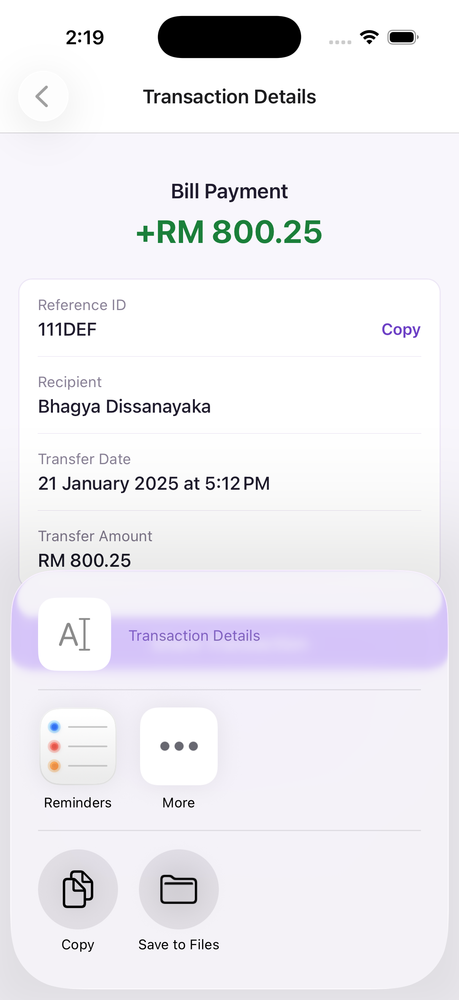

# AEON Bank Mobile Engineer Assessment

A React Native mobile application that allows banking customers to view their latest transactions, search and browse transaction history, inspect transaction details, copy transaction reference IDs, and share transaction information using the native share sheet.

The focus of this implementation is clean engineering practices, maintainable architecture, type safety, reusable components, and production-ready structure rather than heavy UI customization.

## Tech Stack

- React Native

- TypeScript

- Zustand

- React Navigation

- Jest

- React Native `Share` API

- `@react-native-clipboard/clipboard`

- `react-native-toast-message`

## Features

- Welcome screen with a simple banking-themed presentation

- Purple and white application theme

- Custom application launcher icon

- Branded iOS launch screen with centered app icon and AEON Bank title

- Display name configured as **AEON Bank**

- View latest transactions

- Transactions sorted from newest to oldest

- Transactions grouped by transfer date

- Search transactions by recipient name, transaction name, or reference ID

- Positive amounts displayed in green

- Negative amounts displayed in red

- View transaction details

- Copy transaction reference ID to clipboard

- Success feedback after copying a reference ID

- Native transaction sharing using `Share.share()`

- Error toast feedback for failed sharing

- Last updated timestamp after successful data retrieval

- Initial loading state

- Error state with retry

- Empty state

- Search-specific empty state

- Pull-to-refresh

- Type-safe navigation

- Reusable UI components

- Centralized colors and application strings

- Accessibility labels for interactive controls

- Unit tests for utility and business logic

- Subtle bottom spacing to keep the final transaction visually separated from the screen edge
- Application screenshots included in the repository for quick review

## Screenshots

The repository includes screenshots of the key user flows under `src/assets`.

<p align="center">
  
  
  
</p>

<p align="center">
  
  
</p>

The screenshots demonstrate the welcome flow, grouped transaction history, search experience, transaction details, and native sharing functionality.

## Project Structure

```text

src/

├── api/

│   └── transactionApi.ts

├── components/

│   ├── DetailRow.tsx

│   ├── EmptyState.tsx

│   ├── ErrorState.tsx

│   ├── LoadingState.tsx

│   └── TransactionItem.tsx

├── constants/

│   ├── colors.ts

│   └── strings.ts

├── mocks/

│   └── transactions.ts

├── navigation/

│   ├── AppNavigator.tsx

│   └── types.ts

├── screens/

│   ├── TransactionDetailScreen.tsx

│   ├── TransactionListScreen.tsx

│   └── WelcomeScreen.tsx

├── store/

│   └── transactionStore.ts

├── types/

│   └── transaction.ts

└── utils/

    ├── copyToClipboard.ts

    ├── formatCurrency.ts

    ├── formatDate.ts

    ├── formatLastUpdated.ts

    ├── groupTransactionsByDate.ts

    └── shareTransaction.ts

```

## Architecture

The application separates presentation, application state, data access, and reusable business logic.

```text

Screens

   ↓

Zustand Store

   ↓

Transaction API Layer

   ↓

Mock Backend Response

```

Supporting utilities and reusable components remain independent from the data layer.

### Screen Layer

Screens are responsible for:

- rendering UI

- responding to user interaction

- triggering store actions

- navigation

- managing local UI-only state such as the search query

Screens do not directly own backend request logic.

### State Management

Zustand is used for centralized transaction state.

The transaction store manages:

- transaction data

- initial loading state

- refresh state

- error state

- last successful update timestamp

- transaction lookup by reference ID

Zustand was selected because it provides lightweight centralized state management with minimal boilerplate and is appropriate for the scope of this application.

UI-only state such as the search query remains local to the transaction list screen because it does not need to be shared globally.

### API Layer

The API layer abstracts the data source from the UI and store.

Currently the application uses mock backend data, but the implementation can later be replaced with a real REST API without changing the screen layer.

```text

Current:

Screen → Zustand Store → Mock API


Future:

Screen → Zustand Store → REST API

```

## Navigation

Navigation is strongly typed using `RootStackParamList`.

The application contains three main screens:

```text

Welcome

   ↓

Transactions

   ↓

Transaction Details

```

Only the transaction reference ID is passed to the detail screen rather than passing the complete transaction object.

```ts
navigation.navigate('TransactionDetail', {
  transactionId: item.refId,
});
```

The detail screen retrieves the current transaction from Zustand.

This avoids duplicating domain data in navigation state and reduces the risk of stale transaction information.

The transaction detail screen uses a minimal back button so the navigation header remains clean across platforms.

## Transaction Ordering

Transactions are sorted by `transferDate` from newest to oldest before reaching the UI.

The original backend response array is copied before sorting so the source data is not mutated.

```ts
return [...mockTransactionResponse.data].sort(
  (a, b) =>
    new Date(b.transferDate).getTime() - new Date(a.transferDate).getTime(),
);
```

## Transaction Grouping

Transactions are grouped by transfer date before being rendered.

Grouping logic is implemented in a dedicated utility rather than directly inside the screen.

The transaction list uses React Native's `SectionList`, which provides a natural structure for grouped transaction history while retaining list virtualization and pull-to-refresh support.

## Search

Users can search the transaction list using:

- recipient name

- transaction name

- reference ID

Search results are derived from the original transaction list using the current search query.

Filtered transactions are not stored separately in global state because they are derived data. This avoids unnecessary state duplication and synchronization issues.

## Loading and Refresh States

Initial loading and pull-to-refresh are represented separately.

```text

Initial load

→ Full loading state


Pull to refresh

→ Existing transaction list remains visible

→ Native refresh indicator is shown

```

This prevents the existing screen content from disappearing during a refresh operation.

## Last Updated Timestamp

The store records the time of the most recent successful transaction fetch or refresh.

The timestamp is updated only after a successful data operation, so it represents when the visible transaction data was actually refreshed.

## Error Handling

Basic error handling is implemented for transaction loading, refreshing, clipboard-related interactions, and sharing.

If the initial request fails, the user is shown a reusable error state with a retry action.

If a refresh fails after transaction data has already loaded, the existing data remains available rather than being removed.

Sharing failures are logged and surfaced to the user through toast feedback.

## Reusable Components

Repeated UI patterns are extracted into reusable components, including:

- `TransactionItem`

- `DetailRow`

- `LoadingState`

- `ErrorState`

- `EmptyState`

`DetailRow` also supports an optional action, allowing functionality such as copying the transaction reference ID without creating a separate one-off component.

## Copy Reference ID

The transaction detail screen allows the user to copy the transaction reference ID.

Clipboard functionality is isolated in:

```text

src/utils/copyToClipboard.ts

```

The implementation uses `@react-native-clipboard/clipboard`.

After copying, the application provides user feedback confirming that the reference ID was copied successfully.

## Sharing

Transaction details can be shared using React Native's native `Share.share()` API.

The shared content includes:

- reference ID

- transaction name

- recipient name

- transfer date

- transfer amount

If sharing fails, the application handles the rejected promise and displays an error toast rather than allowing an unhandled error.

## Theme and Visual Presentation

Application colors are centralized in:

```text

src/constants/colors.ts

```

The primary visual theme uses purple and white while retaining semantic colors:

- purple for primary actions and branding

- white for surfaces

- green for positive transaction values

- red for negative values and errors

User-facing application strings are centralized in:

```text

src/constants/strings.ts

```

This reduces duplicated literals and provides a straightforward foundation for future localization.

The transaction list uses subtle bottom spacing rather than a visually dominant footer bar, keeping the final row separated from the screen edge without competing with the transaction content.

## App Branding

The application includes:

- custom purple banking-style launcher icon

- display name set to **AEON Bank**

- branded iOS launch screen

- centered application icon on the launch screen

- AEON Bank launch title

The launch screen is intentionally minimal so that it remains consistent with the application's simple, production-focused visual approach.

## Accessibility

Interactive elements include accessibility roles and labels where appropriate.

Examples include:

- transaction rows

- share transaction button

- copy reference ID action

- search input

- retry actions

## Getting Started

### Prerequisites

Ensure the following tools are installed:

- Node.js 22 or later

- npm

- Xcode for iOS development

- CocoaPods / Bundler

- Android Studio for Android development

## Installation

Clone the repository:

```bash

git clone https://github.com/bndissanayaka/aeon-bank-mobile-assessment

```

Move into the project directory:

```bash

cd AeonBankAssessment

```

Install JavaScript dependencies:

```bash

npm install

```

## Running on iOS

Install iOS native dependencies:

```bash

cd ios

bundle install

bundle exec pod install

cd ..

```

Start Metro:

```bash

npm start

```

Then in another terminal:

```bash

npm run ios

```

Alternatively, open:

```text

ios/AeonBankAssessment.xcworkspace

```

in Xcode and run the application from there.

> If port `8081` is already in use locally, Metro can be started on another port and the iOS app launched using the same port.

## Running on Android

Start an Android emulator or connect a physical Android device.

Then run:

```bash

npm run android

```

## Type Checking

```bash

npx tsc --noEmit

```

## Linting

```bash

npm run lint

```

## Testing

```bash

npm test -- --runInBand

```

The current automated tests cover:

- positive currency formatting

- negative currency formatting

- short transaction date formatting

- detailed transaction date formatting

- latest-first transaction ordering

The test suite focuses on deterministic business and utility logic rather than implementation details.

## Assumptions

- Positive amounts represent incoming transactions.

- Negative amounts represent outgoing transactions.

- Backend timestamps are provided in UTC ISO format.

- MYR is used as the display currency.

- `refId` is unique for each transaction.

- The mock API represents the expected backend response structure.

- The supplied transaction values are preserved as provided by the assessment.

- The mock API delay exists only to represent asynchronous backend behavior.

## Engineering Decisions

### Why Zustand?

Zustand provides centralized state with significantly less boilerplate than heavier state-management solutions.

It allows transaction state to be shared between the list and detail screens without passing complete transaction objects through navigation.

### Why an API Layer?

The API layer keeps data access separate from presentation and state management.

This allows the mock implementation to later be replaced with a real backend without requiring changes to the screen layer.

### Why SectionList?

The transaction history is grouped by transfer date.

`SectionList` is more appropriate than rendering grouped transactions manually because it provides:

- list virtualization

- section support

- efficient rendering

- stable key handling

- pull-to-refresh

- empty-state support

### Why Keep Search State Local?

The search query is only relevant to the transaction list screen.

Keeping it in local React state avoids unnecessary global state.

### Why Pass Only the Transaction ID?

The full transaction already exists in application state.

Passing only the reference ID avoids duplicating transaction data in navigation state and ensures the detail screen reads the latest version from the store.

### Why Separate Loading and Refreshing?

Initial loading and refreshing represent different user experiences.

A full-screen loader is appropriate when no transaction data exists yet, while pull-to-refresh should preserve the existing transaction list.

### Why Centralize Colors and Strings?

Centralizing visual constants and user-facing strings improves consistency and reduces duplication.

It also provides a simple foundation for future theming and localization without introducing an unnecessarily complex design system.

### Why Reusable Utilities?

Formatting, grouping, clipboard operations, and sharing are kept outside screen components.

This improves:

- readability

- reuse

- testability

- separation of concerns

## Future Improvements

Given more time, the following improvements could be added:

- Replace the mock API with a real backend integration

- Add API pagination for larger transaction histories

- Add request caching

- Add retry policies with exponential backoff

- Add structured API error models

- Add authentication and secure API communication

- Add offline transaction caching

- Add end-to-end testing

- Add more component and integration tests

- Add dedicated tests for transaction grouping and search

- Add localization

- Add multi-currency support

- Add dark mode

- Expand the current constants into a centralized design system

- Add analytics and production logging

- Add deep linking directly to transaction detail screens

- Add transaction filtering by transaction type or date range

- Add CI checks for linting, type checking, and tests

## Validation

Before submission, the project is validated using:

```bash

npx tsc --noEmit

npm test -- --runInBand

npm run lint

```

These checks validate TypeScript correctness, automated tests, and static code quality.
